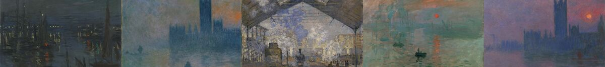
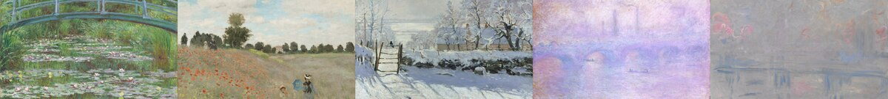

# Giverny

An [Omarchy](https://omarchy.org) theme after the paintings of Claude Monet, with a
dark and a light variant that **switch automatically to suit the painting you pick**.




## Install

```bash
omarchy theme install https://github.com/AnanmayS/omarchy-giverny-theme.git
```

That installs and applies **Giverny** (dark). To add **Giverny Light** and the
automatic light/dark switching:

```bash
bash ~/.config/omarchy/themes/giverny/autoswitch/install.sh
```

## Light and dark that follow the painting

Each of the ten paintings is tagged dark or light in [`paintings.conf`](paintings.conf).
Pick one with the background switcher (<kbd>Super</kbd>+<kbd>Ctrl</kbd>+<kbd>Space</kbd>)
or `omarchy theme bg next`, and the theme switches to the matching variant, keeping the
painting on screen. Night and fog scenes get the dark theme; sunlit fields, snow and
pastel mist get the light one.

The paintings are ordered dark first (01–05), then light (06–10), so cycling with
`bg next` crosses between variants only once per lap.

- Only acts while Giverny or Giverny Light is the current theme.
- Paintings you add that aren't in `paintings.conf` are classified by their brightness.
- Starts at login through a `post-boot` hook; log at
  `~/.local/state/omarchy/giverny-autoswitch.log`.
- After `omarchy theme update`, re-run `autoswitch/install.sh` to resync Giverny Light's paintings.
- Requires `inotify-tools` (the installer adds it if missing).

Remove the switcher and Giverny Light (Giverny itself stays):

```bash
bash ~/.config/omarchy/themes/giverny/autoswitch/uninstall.sh
```

## Palettes

**Giverny** (dark): twilight-pond blue, canvas-cream text, wisteria accent, poppy red,
the orange sun of *Impression, Sunrise*, lily-pad sage.


**Giverny Light**: warm parchment cream (not white), deep indigo ink, and colours
deepened to keep roughly 4:1 contrast on the cream.


Swatches: background, lighter background, foreground, accent, red, orange, yellow,
green, cyan, blue, magenta, brown.

## Paintings

All by Claude Monet (1840–1926), public domain. Scans from
[Wikimedia Commons](https://commons.wikimedia.org).

| | Painting | Variant |
|---|---|---|
| 01 | The Port of Le Havre, Night Effect (1873) | dark |
| 02 | The Houses of Parliament, Sunset (1902) | dark |
| 03 | The Houses of Parliament, Effect of Fog (1903–04), The Met | dark |
| 04 | The Saint-Lazare Station (1877), Musée d'Orsay | dark |
| 05 | Impression, Sunrise (1872), Musée Marmottan Monet | dark |
| 06 | The Japanese Footbridge (1899), National Gallery of Art | light |
| 07 | Poppy Field (1873), Musée d'Orsay | light |
| 08 | The Magpie (1868–69), Musée d'Orsay | light |
| 09 | Waterloo Bridge, Effect of Fog (1903), Hermitage | light |
| 10 | Charing Cross Bridge | light |

## License

Theme files and scripts: MIT. The paintings are public domain and not covered by
the license.
